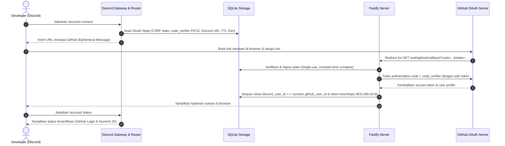
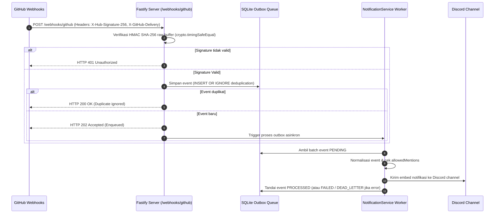

# Arsitektur Sistem — Discord Project Management Bot

Dokumen ini menjelaskan arsitektur perangkat lunak, pemisahan layer (*Clean Architecture*), aliran data (*data flow*), dan diagram urutan (*sequence diagrams*) untuk bot Discord terintegrasi GitHub.

---

## 1. Pemisahan Layer (Clean Architecture)

Struktur kode sumber di `src/` menerapkan prinsip isolasi dependensi secara ketat:

```text
src/
├── domain/                      # Aturan bisnis murni, entitas, dan custom errors (tanpa dependensi eksternal)
│   ├── types.ts                 # Domain models (Task, Project, AccountLink, Role, AuditEntry, dll.)
│   ├── policies.ts              # State machine (StatusTransitionPolicy, ConcurrencyPolicy)
│   └── errors.ts                # Hierarchy custom domain errors (ConflictError, UnauthorizedError, dll.)
│
├── application/                 # Use cases, ports (interfaces), dan layanan aplikasi
│   ├── ports/                   # Kontrak interface (IRepositories, IGitHubService, ICryptoService, dll.)
│   ├── services/                # AuthorizationService (RBAC), AuditService, NotificationService
│   └── usecases/                # Use cases spesifik (OAuth link, disconnect, daily digest, dll.)
│
├── infrastructure/              # Implementasi teknis dependensi eksternal & framework
│   ├── crypto/                  # Enkripsi AES-256-GCM & HMAC hashing
│   ├── persistence/             # Koneksi better-sqlite3, migrator, dan implementasi repository
│   ├── github/                  # Adapter Octokit REST, App JWT Auth, GraphQL Projects v2, Error Mapper
│   ├── http/                    # Server Fastify, endpoint webhook (/webhooks/github) & OAuth callback
│   └── scheduling/              # DigestScheduler berbasis Croner dengan SQLite lease locks
│
├── interfaces/                  # Adapter antarmuka interaksi pengguna
│   └── discord/                 # Gateway client, registry slash command, interaction router, paginators, modals
│
├── config/                      # Validasi environment & secrets resolver via Zod
└── main.ts                      # Composition root & lifecycle management (startup & graceful shutdown)
```

---

## 2. Aliran Data & Diagram Interaksi

### 2.1 Alur Penautan Akun (OAuth 2.0 PKCE Account Linking)



### 2.2 Alur Ingesti Webhook GitHub → Discord Notification



---

## 3. Ketahanan Sistem & Graceful Shutdown

Saat sinyal `SIGINT` atau `SIGTERM` diterima:
1. Penjadwal cron (`DigestScheduler`) dan worker outbox dihentikan agar tidak mengambil task baru.
2. Server HTTP Fastify ditutup secara tertib (`httpServer.close()`).
3. Koneksi WebSocket Discord Gateway diputus secara aman (`discordGateway.destroy()`).
4. Database SQLite melakukan checkpoint commit WAL sebelum koneksi ditutup (`dbManager.close()`).
